# dotfiles

My SwayFX desktop on Fedora (Arch and Debian work too): a bar whose popups
are written for it, our own notifications, wallpapers from Wallhaven with
the colors taken from them, and one palette for everything.

https://github.com/user-attachments/assets/e1ddd2cb-1d7e-44a4-8a75-537e803ea8c0

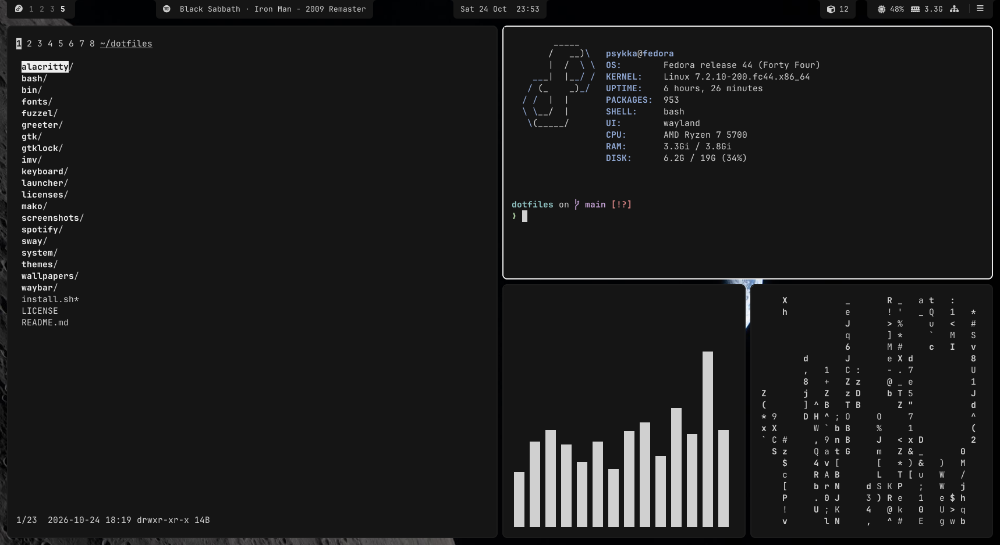

## Install

```sh
git clone git@github.com:Psykka/dotfiles.git ~/dotfiles
~/dotfiles/install.sh
```

`install.sh` installs the packages, applies the color theme and links the
configs with GNU Stow. Anything already in the way is moved to
`~/.dotfiles-backup/<date>`. It also sets up the login screen (greetd +
tuigreet), nnn and imv as the default file manager and image viewer, and
VSCode's keyring. Log out and pick Sway at the login screen.

On Fedora, SwayFX comes from its COPR; on Arch, from the AUR (with paru or
yay). Debian has no SwayFX, so there it runs on plain sway, without rounded
corners and shadows.

## What's in it

**The bar** (Waybar) opens popups of its own (GTK + layer shell), made so
that nothing in them ever jumps: every list, page and message has its room
from the start.

- **Media**: click the song for a compact player with the cover, seek and
  volume (scroll on the speaker button, or click it for the volume line).
- **Calendar**: click the clock. Today in the middle of a fixed six-week
  month, and the last 30 notifications beside it.
- **Updates**: the cube shows pending packages (and a new Fedora release),
  to update in a terminal.
- **Menu** (`☰`): network and power, plus these pages:
  - **Sound**: the output and input in use with their volumes, a meter of
    the microphone and its hardware gain, each app's volume (and moving an
    app to the device in use), and fixes for a silent microphone.
  - **Displays**: the displays side by side (click one to set it up), the
    main display, resolution and scale; kept for the next login.
  - **Bluetooth** (when there is an adapter): connect, pair checking the
    code, forget.

**Notifications** come from our own server (`notifications.py`, in place of
mako): cards all the same size, a bar for the time left that stops under
the mouse, buttons, progress, and an indicator for the volume keys.

**Wallpapers**: clock, then "Wallpaper" (or "Wallpaper" under System in the
launcher). Search Wallhaven or pick one already downloaded, take the colors
from it (or keep the theme's), adjust the picture, try it on the desktop,
then save or discard.

**Workspaces per display**: each display has its own 1 to 6. `Super` +
scroll goes to the previous or next, and past the last opens a new one.

Also: the app launcher with a System entry pinned on top (fuzzel), every
keybinding searchable and runnable (`Super + /`), clipboard history, area
screenshots, lock screen (gtklock), grayscale icons and a VSCode theme in
the same colors.

## Keybindings

| Keys | |
|---|---|
| `Super + Enter` | Terminal (Alacritty) |
| `Super + E` | Files (nnn) |
| `Super + Space` | App launcher |
| `Super + /` | All keybindings |
| `Super + Esc` | System menu |
| `Super + V` | Clipboard history |
| `Print`, `Shift + Print` / `Super + Shift + S` | Screenshot of the screen, of an area |
| `Super + 1`…`6`, `Super + Shift + 1`…`6` | Go to workspace, move the window there |
| `Super + scroll` | Previous / next workspace |
| `Super + =`, `Super + -` | Volume up, down |
| `Super + F` | Toggle floating |
| `Super + Shift + Q` | Close window |
| `Super + L` | Lock |
| `Super + Shift + R` | Reload sway |

## Colors

The palette is `themes/dark.ini`. `theme` fills `themes/templates` from it
for sway, Waybar, the popups and notifications, GTK, Alacritty, fuzzel,
imv and VSCode; after editing the palette, run `theme` to apply.

The wallpaper and its colors picked in the wallpaper panel are this
machine's choice: they go to `~/.local/state/theme-local.ini`, on top of
the palette, not into the repo. The files `theme` writes are not in git
either.

## Screenshots

| | |
|---|---|
| 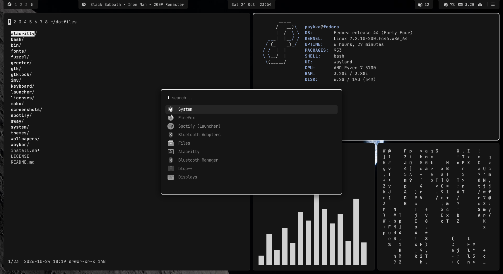 | 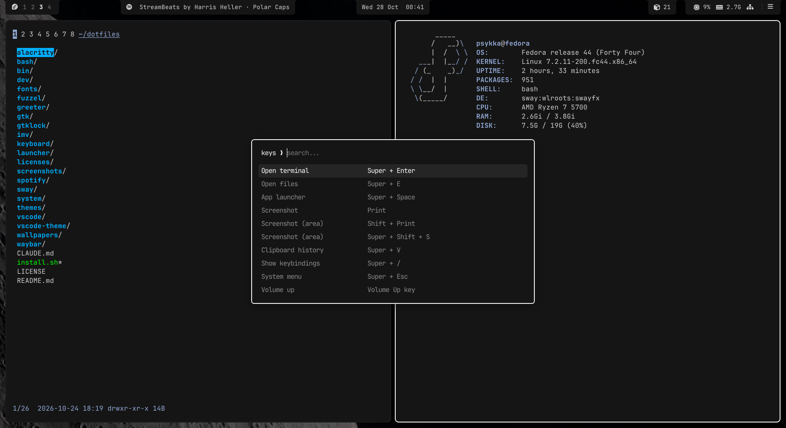 |
| App launcher (`Super + Space`) | Keybindings (`Super + /`) |
| 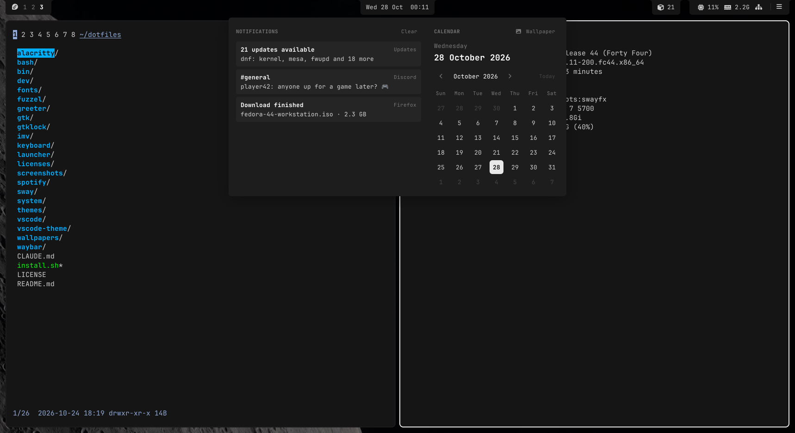 | 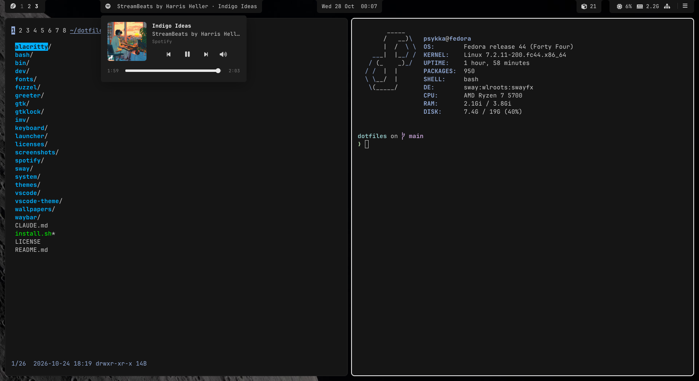 |
| Calendar and the last notifications (click the clock) | Media player (click the song) |
| 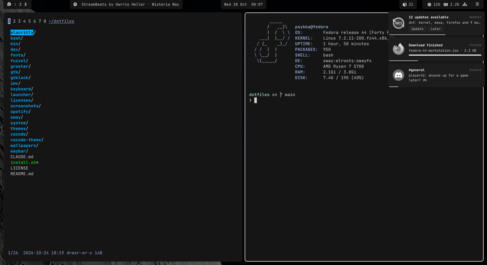 | 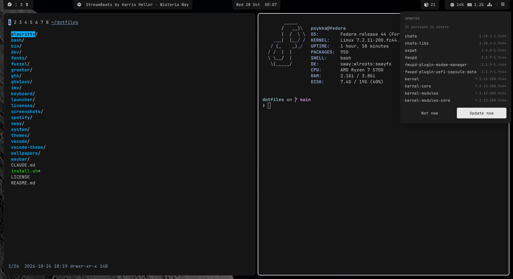 |
| Notifications, same-size cards | Pending updates (the cube) |
| 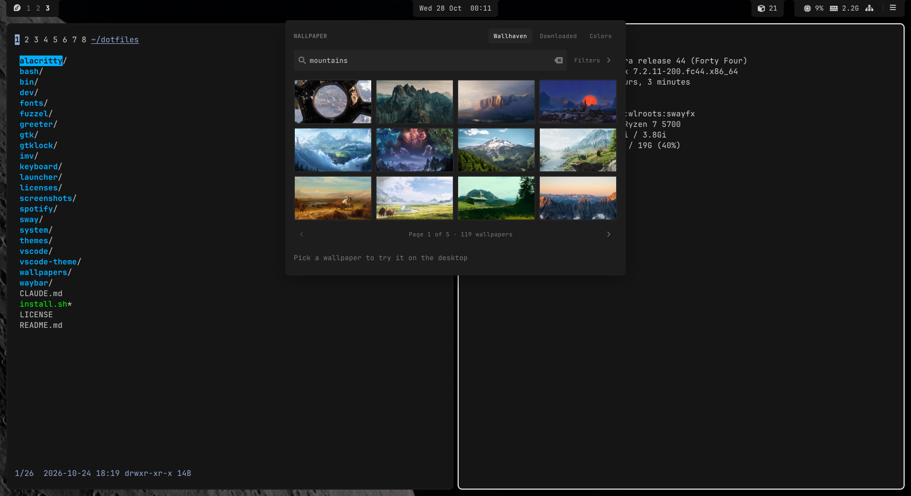 | 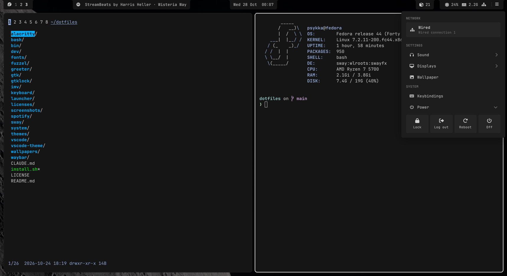 |
| Wallpapers from Wallhaven (clock, then "Wallpaper") | Network, settings and power (`☰`) |
| 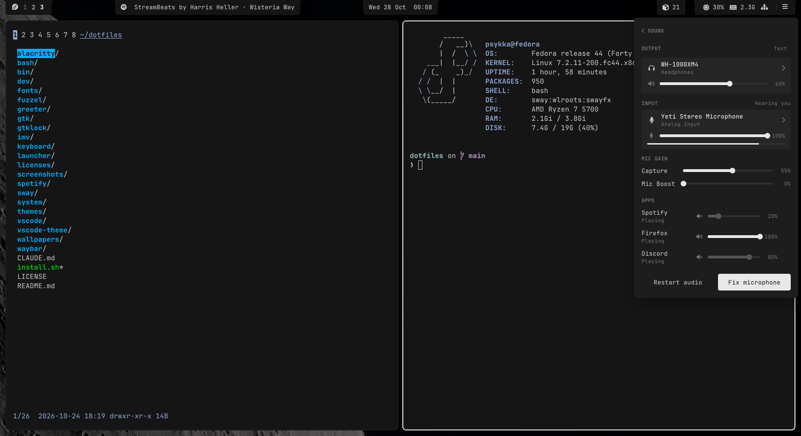 | 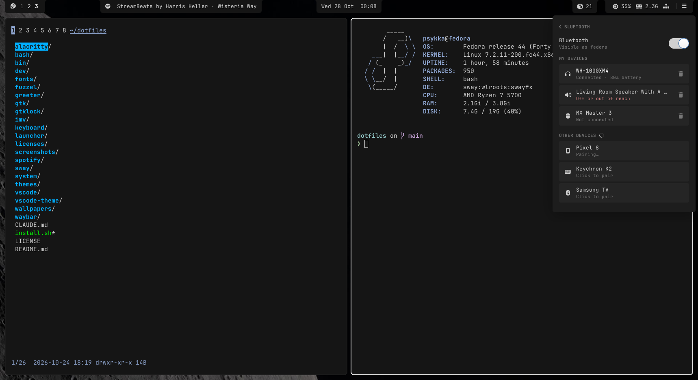 |
| Sound: devices, mic gain, each app's volume | Bluetooth: connect, pair, forget |
| 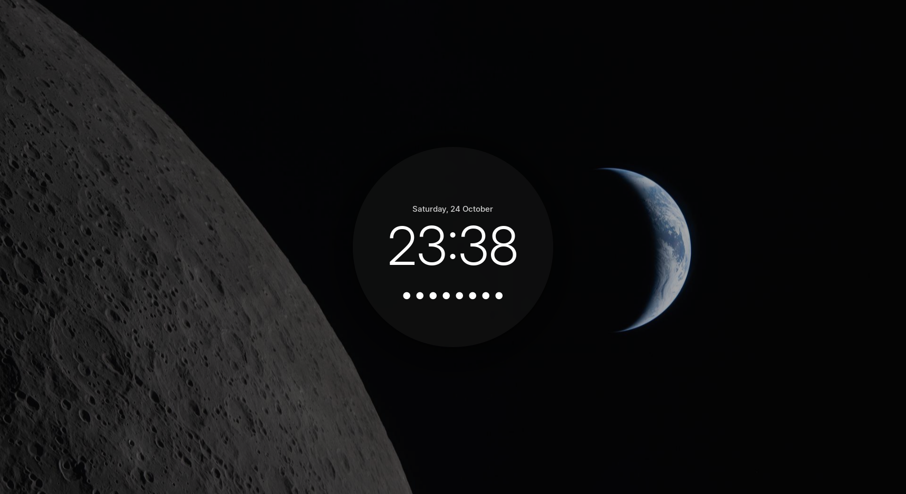 | 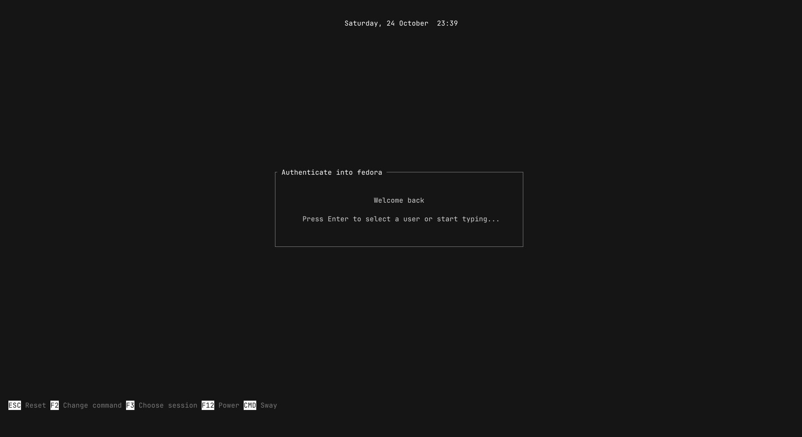 |
| Lock screen (`Super + L`) | Login screen (greetd + tuigreet) |

## Working on it

Each top-level folder is a Stow package linked into `~`; `dev/` is not.
The bar popups live in `waybar/.config/waybar/panel.py`. After changing
them, `dev/panel-sizes.py` opens each one on the running sway, goes through
its states and fails if anything changes size;
`dev/notification-sizes.py` does the same for the notifications. A
pretend media player, sound server and Bluetooth (`dev/fake-player.py`,
`dev/fake_audio.py`, `dev/fake_bluetooth.py`) let them be tried on a
machine without any of those.

## Credits

Wallpaper: "The Edge of Two Worlds", taken by the Artemis II crew.
Image Credit: NASA ([source](https://www.nasa.gov/image-detail/amf-art002e009285/)).
Details in [`wallpapers/.local/share/wallpapers/CREDITS.md`](wallpapers/.local/share/wallpapers/CREDITS.md).
The wallpapers in the Wallhaven screenshot are search results from
[wallhaven.cc](https://wallhaven.cc), by their authors.

Music in the video: StreamBeats by Harris Heller, made to be used in
streams and videos.

Fetch: [ufetch](https://gitlab.com/jschx/ufetch) by J Schillinger, MIT license
([`licenses/ufetch`](licenses/ufetch)).

## License

Copyright © 2026 Psykka. Distributed under the [GorillaPL](LICENSE) 🦍,
except the wallpaper, a NASA image (see Credits).
